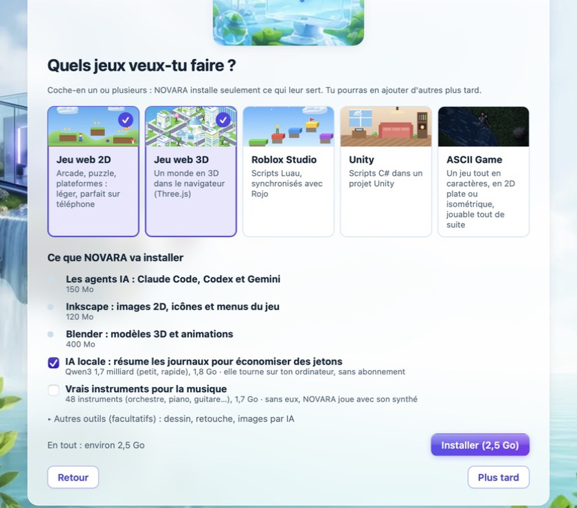
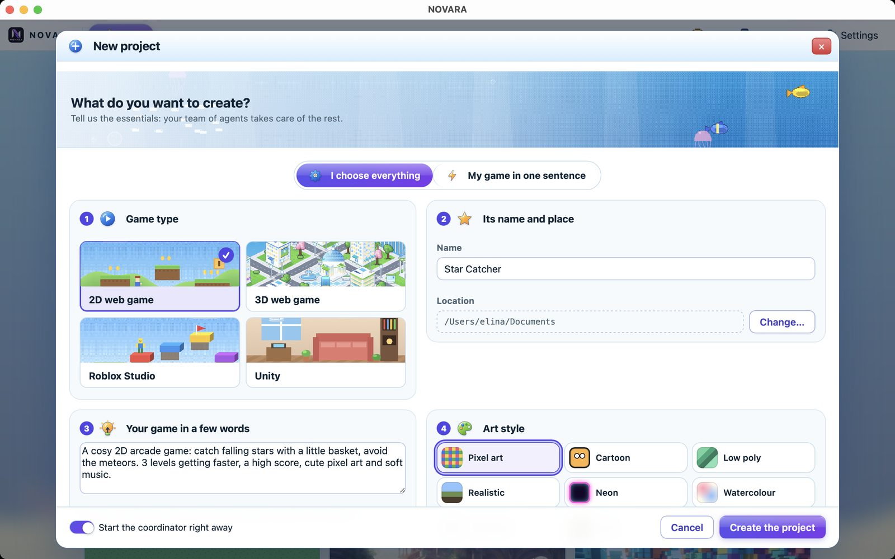
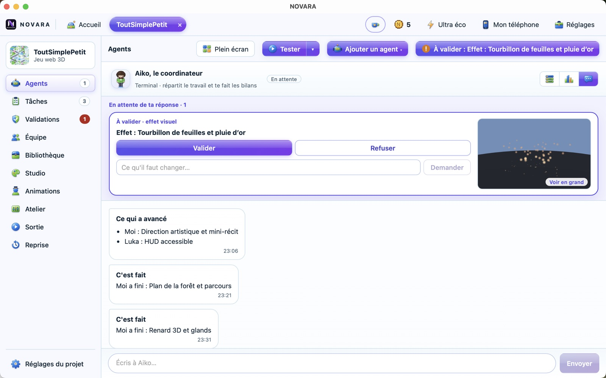
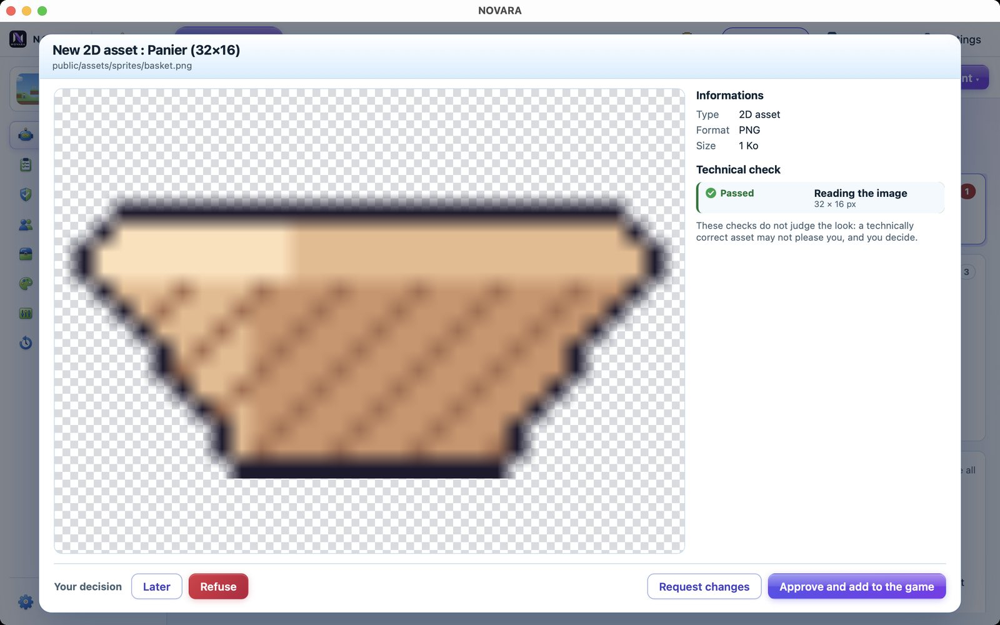
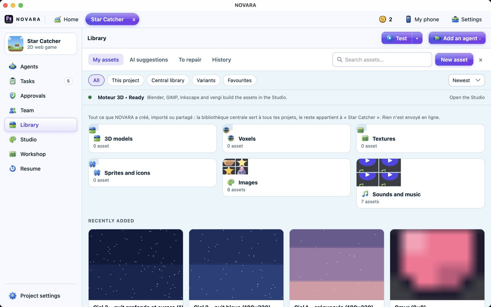
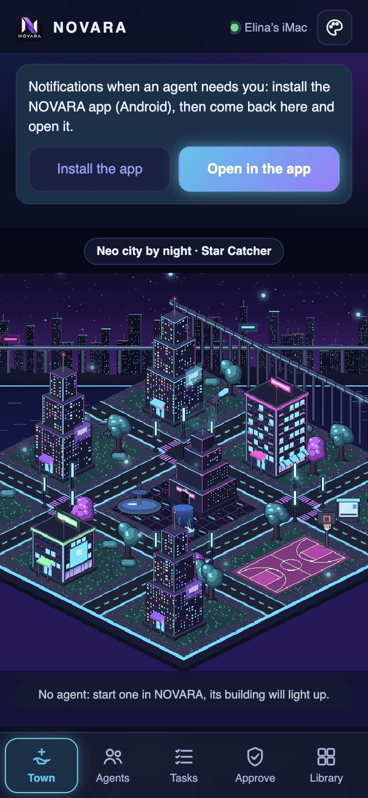

# Guide de NOVARA

Tout ce qu'il faut pour installer NOVARA et créer ton premier jeu, puis aller plus loin. Pas besoin de savoir coder. Une question précise ? Regarde la [FAQ](FAQ.fr.md).

## 1. Ce qu'il te faut

- Un Mac avec macOS 11 ou plus récent (Apple Silicon ou Intel), ou un PC avec Windows 10 ou 11 (64 bits).
- Au moins un compte IA : un abonnement Claude, un compte ChatGPT ou un compte Google. NOVARA est gratuit, mais les agents utilisent ton propre compte.
- De la place sur le disque pour les outils que tu choisis d'installer (Blender, générateur d'images…).

## 2. Installer NOVARA

**Sur Mac**

1. Télécharge `NOVARA_<version>_macos.dmg` sur la [page des versions](https://github.com/elinahart/novara-releases/releases/latest).
2. Ouvre-le et glisse **NOVARA** dans **Applications**.
3. La première fois, macOS dit qu'il ne peut pas vérifier l'app, car elle n'est pas notariée par Apple. Ouvre **Réglages Système › Confidentialité et sécurité**, descends et clique sur **Ouvrir quand même**. Il ne faut le faire qu'une fois.

**Sur Windows**

1. Télécharge `NOVARA_<version>_windows_x64-setup.exe` sur la [page des versions](https://github.com/elinahart/novara-releases/releases/latest).
2. Ouvre-le et suis l'installation.
3. Si Windows affiche « Windows a protégé votre ordinateur », clique sur **Informations complémentaires**, puis **Exécuter quand même**.

## 3. Le premier lancement, en 5 étapes

1. **Bienvenue** : choisis « Installer NOVARA sur cet ordinateur ». L'autre choix, « Seulement piloter un autre ordinateur », sert à un portable qui commande un ordinateur plus puissant (voir la partie 12).
2. **Tes jeux** : coche les jeux que tu veux faire. NOVARA choisit les outils à installer et te montre la liste. Tu n'as qu'un bouton à cliquer.
3. **Comptes IA** : connecte Claude Code, Codex ou Gemini. NOVARA les installe pour toi.
4. **Ton style** : choisis ton thème et ton personnage.
5. **Prêt** : NOVARA vérifie pour de vrai que tout marche et te dit ce qui manque.

## 4. Créer ton premier jeu

1. Sur l'accueil, clique sur **Nouveau projet**.
2. Choisis le type de jeu : **Jeu web 2D**, **Jeu web 3D**, **Roblox Studio**, **Unity** ou **ASCII Game** (tout en caractères, vue plate ou isométrique).
3. Décris ton jeu en une phrase, donne-lui un nom, choisis un style et la taille du projet : **Petit prototype** ou **Jeu complet**.
4. Valide. Le coordinateur découpe ton idée en tâches et recrute les agents.

Tu as déjà un dossier de jeu ? Utilise **Lier un dossier existant** sur l'accueil.

## 5. L'écran d'un projet

Le menu suit la vie d'un jeu, en quatre étapes.

| Étape | Menus | À quoi ça sert |
|---|---|---|
| 1. Idée | Équipe, Tâches | Voir qui fait quoi, les problèmes ouverts, l'avancement |
| 2. Construction | Agents, Studio, Animations, Personnages, Atelier, Bibliothèque | Parler aux agents, créer et ranger les ressources |
| 3. Validation | Validations | Donner ton avis sur chaque ressource |
| 4. Sortie | Sortie | Préparer la page du jeu et ses images |

En haut à droite : **Tester** lance ton jeu, **Lancer une partie** (Unity et Roblox) le fait tourner quelques secondes dans le moteur et montre ses erreurs, **Vérifier** contrôle le projet, et **Ajouter un agent** recrute quelqu'un de plus. **Réglages du projet** regroupe les choix de ce projet.

## 6. Travailler avec les agents

- **Le coordinateur** est ton seul interlocuteur si tu veux. Écris-lui ton objectif : il répartit le travail et te raconte l'avancement. Il porte le nom de ton personnage et il dit « je ».
- **Les idées** : au-dessus de la zone de message, NOVARA et les agents proposent de petites idées, comme « Rendre les monstres plus forts ». Clique pour la mettre dans ton message, ou sur la croix pour la retirer.
- **Les vues** : **Fenêtres d'agent** montre leurs terminaux, **Ville** montre chaque agent dans sa maison, **Discussion** montre le chat.
- **Les images** : colle une image dans la zone de message avec Cmd+V (Ctrl+V sur Windows).
- **Ta voix** : tu peux dicter tes messages. La reconnaissance se fait sur ton ordinateur.
- **Combien d'agents** : jusqu'à 6, selon ce que ton ordinateur supporte. NOVARA te propose une équipe dans « Ressources et agents ».

Les agents se parlent en anglais entre eux, parce que ça coûte moins de jetons. Tout ce qui t'est destiné reste dans ta langue.

## 7. Valider les ressources

Quand un agent crée un sprite, un modèle 3D, une interface ou un son, NOVARA le contrôle puis te le montre. Tu réponds **Valider**, **Refuser** ou **Demander une correction**, avec un commentaire si tu veux.

- Une seule validation par objet : ses autres formats, ses textures et ses vues suivent ta réponse.
- Une animation de modèle 3D se regarde dans la fenêtre, animation par animation, et jamais sur une simple photo.
- Tu peux revenir sur une décision depuis le chat.

## 8. Tester ton jeu

Clique sur **Tester**. NOVARA lance le jeu et lit ses erreurs pour que les agents puissent les corriger. Les jeux web se jouent aussi sur ton téléphone. Pour Unity, NOVARA ouvre le jeu dans l'éditeur.

## 9. La bibliothèque et les aperçus 3D

Chaque projet a sa bibliothèque, et la **bibliothèque centrale** sert à tous tes projets. Tu y retrouves les modèles, images, sons, versions, variantes et favoris.

Clique sur un modèle pour le faire tourner. Les **GLB, GLTF, FBX et OBJ** s'ouvrent avec leurs textures, et leurs animations se jouent avec une barre de lecture. Les STL, PLY, DAE, 3DS, 3MF et USDZ sont aussi pris en charge. Les fichiers `.blend` ne s'ouvrent pas dans l'aperçu : ils demandent Blender.

## 10. Les personnages et les voix

Le menu **Personnages** liste les personnages de ton jeu, tels que les agents les enregistrent. Pour chacun, choisis une voix déjà dans NOVARA. Le coordinateur est prévenu tout de suite que ce personnage a cette voix.

- Ajoute une voix dans **Atelier › Voix**, ou depuis l'onglet **Voix** du téléphone.
- Une voix est toujours la copie d'une vraie voix : la personne doit avoir donné son accord, et NOVARA le lui demande.

**Créer un personnage.** Dans le menu **Personnages**, **Créer un personnage** fabrique un personnage 3D avec Blender : règle le corps avec les curseurs (ils restent dans des proportions humaines), choisis un style (réaliste, héros de BD, manga, cartoon, chibi), des traits de visage, une tenue ou des habits ajustés au corps. Il arrive avec un squelette prêt pour les animations Mixamo. Tu peux aussi importer un personnage fait dans **VRoid Studio** (`.vrm`) : NOVARA le garde tel quel.

## 11. Studio, Atelier et Animations

- **Studio** : demande une ressource en mots simples. NOVARA montre son plan avant de commencer.
- **Atelier** : sons, musiques, ambiances, voix et effets, créés sur ton ordinateur.
- **Animations** : regarde les animations de tes personnages 3D, place une remarque au bon moment et envoie-la à l'agent. Ce menu existe pour les jeux en 3D.
- **Ressources libres** (dans le Studio) : matières, ciels, sons, icônes, touches de clavier et de manette, polices, gratuits et utilisables dans un jeu vendu (Poly Haven, ambientCG, Kenney, Quaternius, KayKit…). Chaque fichier est inscrit dans les crédits du jeu (`CREDITS.md`), avec le texte à copier dans ton générique.
- **Image vers 3D** (facultatif, Réglages › Installation) : à partir d'une image, les agents obtiennent un brouillon de modèle 3D qu'ils retravaillent ensuite dans Blender. TripoSR marche sur les Mac à puce Apple (environ deux minutes et demie sur un Mac M1 de 8 Go) et sur les PC ; TRELLIS demande une carte NVIDIA avec 16 Go de mémoire vidéo.
- **Pixelorama et Laigter** (facultatifs, Réglages › Installation) : pixel art, animations et tuiles, et relief des sprites 2D pour la lumière.
- **Meshy 3D** (facultatif, payant, Réglages › Services connectés) : tes agents créent images, modèles 3D, textures, squelettes et animations avec ton compte Meshy. Le prix et l'image s'affichent avant chaque dépense.

## 12. NOVARA sur ton téléphone et à distance

**Relier ton téléphone**

1. Clique sur **Mon téléphone** en haut de NOVARA.
2. Scanne le QR code, avec ton téléphone sur le même Wi-Fi que l'ordinateur.
3. Sur Android, installe l'app NOVARA proposée par la page : elle te prévient quand un agent a besoin de toi. Sur iPhone, le navigateur suffit.

Tu retrouves les onglets **Ville**, **Chat**, **Tâches**, **Valider**, **Biblio** et **Voix**.

- **Biblio** : regarde toutes les ressources, avec les modèles 3D et leurs animations, et ajoute des photos ou n'importe quel fichier au projet (200 Mo au plus).
- **Chat** : écris au coordinateur et envoie-lui une photo.
- **Voix** : donne une voix à un personnage ou enregistre quelqu'un, avec son accord.

**Hors de chez toi** : installe Tailscale sur l'ordinateur et le téléphone. NOVARA affiche alors un deuxième QR code.

**Depuis un portable** : sur le portable, choisis « Seulement piloter un autre ordinateur » au premier lancement. Relie-le avec le code à 6 chiffres du gros ordinateur, dans **À distance**. Rien ne passe par Internet, tu peux retirer un appareil à tout moment, et « Regarder seulement » l'empêche de changer quoi que ce soit.

## 13. Économiser jetons et mémoire

- **Éco, Équilibré, Performance** : choisis la puissance des modèles IA pour chaque projet. Éco coûte le moins de jetons.
- **Ultra éco** : limite le projet à 2 agents et réduit la consommation de jetons.
- **Mode léger** : économise la mémoire et le processeur de ton ordinateur, sans toucher au nombre d'agents. Pratique sur une petite machine.
- Images, sons et musiques faits par les outils locaux ne coûtent aucun jeton.

## 14. Reprendre plus tard

Quand tu rouvres un projet, NOVARA te montre où tu en étais : ce qui est fait, ce qui reste et les agents interrompus. **Tout relancer** ou **Relancer** repart avec la même équipe. **Plus tard** ferme simplement la fenêtre, sans lancer d'agent.

## 15. Sortir ton jeu

Le menu **Sortie** ouvre le **Kit de sortie** : une IA de ton choix joue au jeu, prend de vraies captures et écrit la page de la boutique en français ou en anglais. Tu corriges les textes, et NOVARA prépare les images aux tailles officielles de Steam.

## 16. Le côté jeu de NOVARA

- **Thèmes** : ils changent toute l'app, et tu peux en créer un avec une IA. Trois thèmes sont secrets.
- **Mini-jeux** : clique sur les objets de ta ville. Un point donne une pièce.
- **Boutique** : dépense tes pièces en bâtiments, personnages, chapeaux et animaux.
- **Créations et plugins** : installe les thèmes, modèles de jeux et guides de la communauté, ou partage les tiens.

## 17. Besoin d'aide

Regarde la [FAQ](FAQ.fr.md). Si tu trouves un bug, utilise **Signaler un bug** dans NOVARA ou ouvre un ticket sur [GitHub](https://github.com/elinahart/novara-releases/issues).
