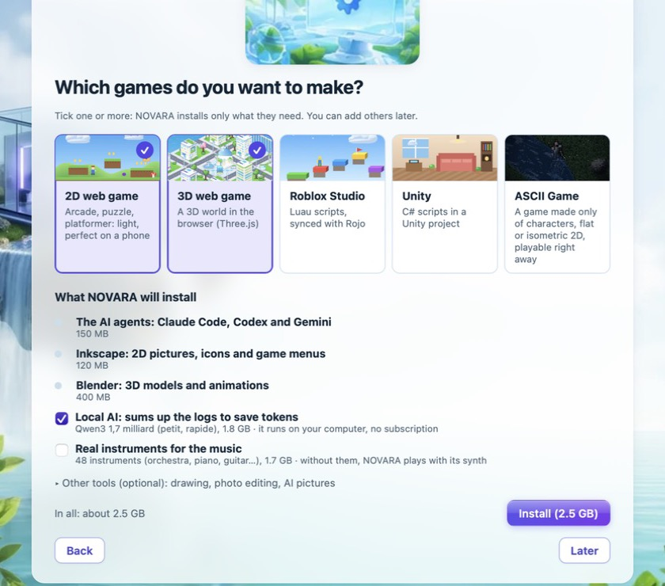
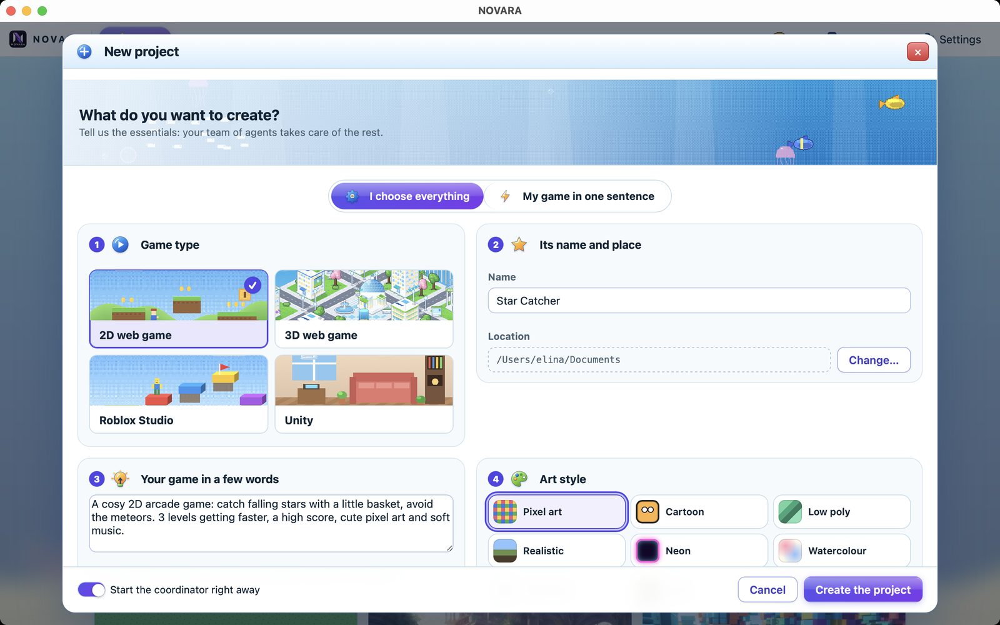
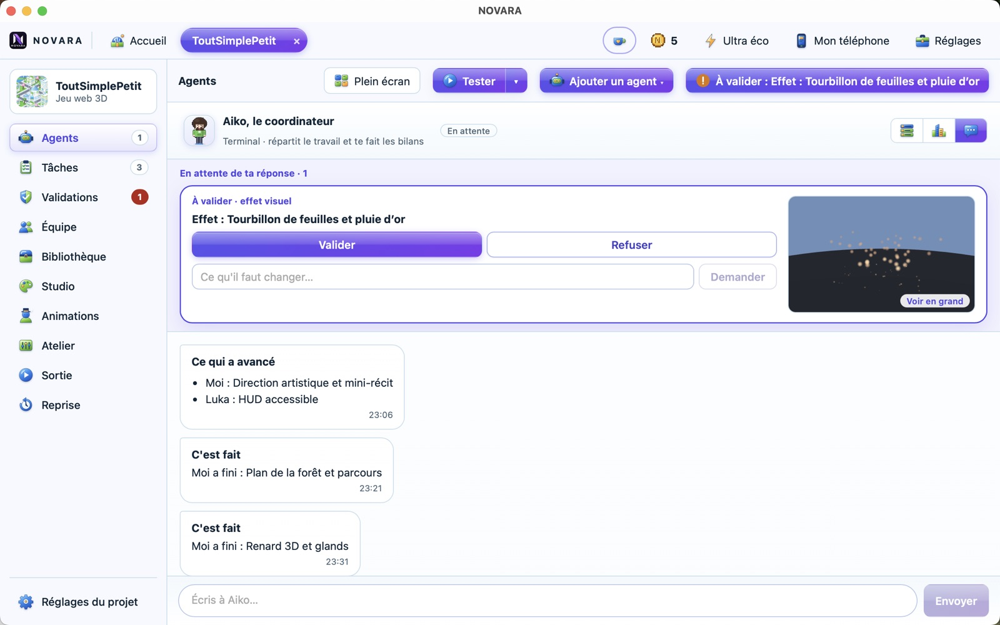
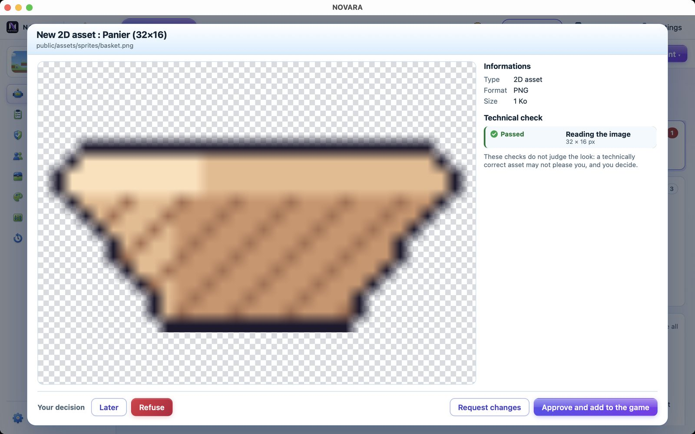
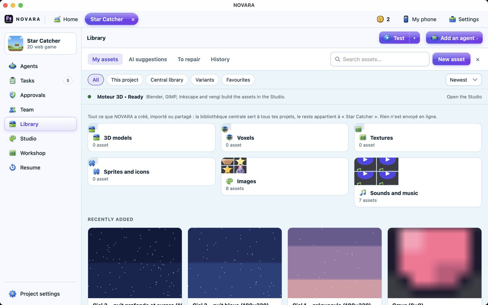
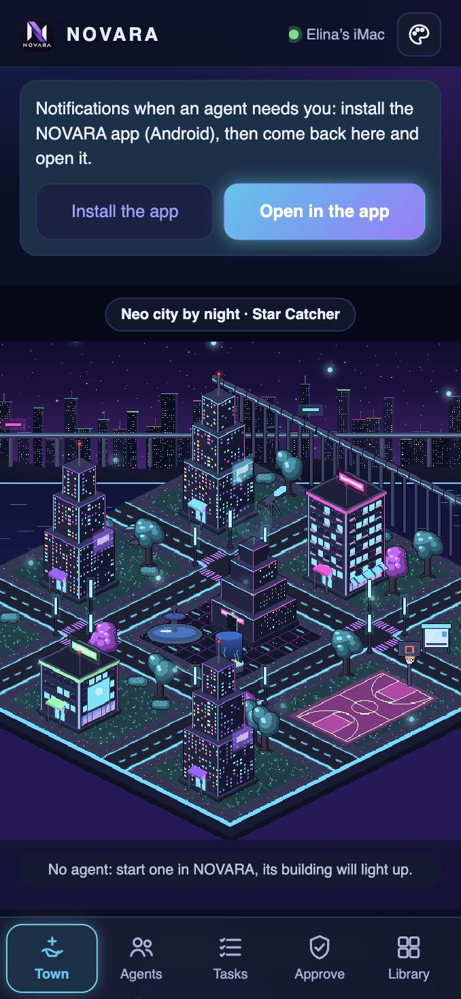

# NOVARA guide

Everything you need to install NOVARA, make your first game and go further. You don't need to know how to code. Looking for something specific? See the [FAQ](FAQ.md).

## 1. What you need

- A Mac with macOS 11 or later (Apple Silicon or Intel), or a PC with Windows 10 or 11 (64-bit).
- At least one AI account: a Claude subscription, a ChatGPT account or a Google account. NOVARA is free, but the agents use your own account.
- Disk space for the tools you choose to install (Blender, the image generator…).

## 2. Install NOVARA

**On Mac**

1. Download `NOVARA_<version>_macos.dmg` from the [releases page](https://github.com/elinahart/novara-releases/releases/latest).
2. Open it and drag **NOVARA** into **Applications**.
3. The first time, macOS says it cannot check the app, because it is not notarised by Apple. Open **System Settings › Privacy & Security**, scroll down and click **Open Anyway**. You only do this once.

**On Windows**

1. Download `NOVARA_<version>_windows_x64-setup.exe` from the [releases page](https://github.com/elinahart/novara-releases/releases/latest).
2. Open it and follow the installer.
3. If Windows shows “Windows protected your PC”, click **More info**, then **Run anyway**.

## 3. First launch, in 5 steps

1. **Welcome**: choose to install NOVARA on this computer. The other choice, “Only control another computer”, is for a laptop that drives a more powerful computer (see part 12).
2. **Your games**: tick the games you want to make. NOVARA picks the tools and shows you the list. You only have one button to click.
3. **AI accounts**: connect Claude Code, Codex or Gemini. NOVARA installs them for you.
4. **Your style**: choose your theme and your character.
5. **Ready**: NOVARA really checks that everything works and tells you what is missing.

## 4. Make your first game

1. On the home screen, click **New project**.
2. Choose the kind of game: **2D web game**, **3D web game**, **Roblox Studio**, **Unity** or **ASCII Game** (all characters, flat or isometric view).
3. Describe your game in one sentence, name it, choose a style and a size: **Small prototype** or **Full game**.
4. Confirm. The coordinator splits your idea into tasks and recruits the agents.

Already have a game folder? Use **Link an existing folder** on the home screen.

## 5. The project screen

The menu follows the life of a game, in four steps.

| Step | Menus | What it is for |
|---|---|---|
| 1. Idea | Team, Tasks | See who does what, open problems, progress |
| 2. Build | Agents, Studio, Animations, Characters, Workshop, Library | Talk to the agents, make and store assets |
| 3. Approval | Approvals | Give your opinion on each asset |
| 4. Release | Release | Prepare the game's page and pictures |

At the top right, **Test** starts your game, **Start a test run** (Unity and Roblox) runs it a few seconds in the engine and shows its errors, **Check** checks the project, and **Add an agent** recruits one more. **Project settings** gathers the choices of this project.

## 6. Working with the agents

- **The coordinator** can be the only one you talk to. Write your objective: it shares out the work and tells you how it goes. It carries your character's name and says “I”.
- **Ideas**: above the message box, NOVARA and the agents suggest small ideas, like “Make the monsters stronger”. Click one to put it in your message, or the cross to remove it.
- **The views**: **Agent windows** shows their terminals, **Town** shows each agent in their house, **Chat** shows the conversation.
- **Pictures**: paste a picture in the message box with Cmd+V (Ctrl+V on Windows).
- **Your voice**: you can dictate your messages. Recognition runs on your computer.
- **How many agents**: up to 6, depending on what your computer can handle. NOVARA suggests a team in “Resources and agents”.

Agents talk to each other in English, because it costs fewer tokens. Everything meant for you stays in your language.

## 7. Approving assets

When an agent makes a sprite, a 3D model, an interface or a sound, NOVARA checks it and then shows it to you. You answer **Approve**, **Refuse** or **Ask for a fix**, with a comment if you like.

- One approval per object: its other formats, textures and views follow your answer.
- A 3D model's animation plays in the window, one by one, never as a mere picture.
- You can come back on a decision from the chat.

## 8. Testing your game

Click **Test**. NOVARA starts the game and reads its errors so the agents can fix them. Web games can also be played on your phone. For Unity, NOVARA opens the game in the editor.

## 9. The library and 3D previews

Each project has its library, and the **central library** serves all your projects. It holds models, pictures, sounds, versions, variants and favourites.

Click a model to turn it around. **GLB, GLTF, FBX and OBJ** files open with their textures, and their animations play with a timeline. STL, PLY, DAE, 3DS, 3MF and USDZ are supported too. `.blend` files do not open in the preview: they need Blender.

## 10. Characters and voices

The **Characters** menu lists your game's characters, as the agents register them. For each one, choose a voice already in NOVARA. The coordinator is told right away that this character has this voice.

- Add a voice in **Workshop › Voice**, or from the phone's **Voices** tab.
- A voice is always a copy of a real voice: the person must have agreed, and NOVARA asks for it.

## 11. Studio, Workshop and Animations

- **Studio**: ask for an asset in plain words. NOVARA shows its plan before it starts.
- **Workshop**: sounds, music, ambiences, voices and effects, made on your computer.
- **Animations**: watch your 3D characters' animations, pin a remark at the right moment and send it to the agent. This menu is there for 3D games.

## 12. NOVARA on your phone and from afar

**Link your phone**

1. Click **My phone** at the top of NOVARA.
2. Scan the QR code, with your phone on the same Wi-Fi as the computer.
3. On Android, install the NOVARA app offered by the page: it tells you when an agent needs you. On iPhone, the browser is enough.

You get the **Town**, **Chat**, **Tasks**, **Approve**, **Library** and **Voices** tabs.

- **Library**: look at every asset, with 3D models and their animations, and add photos or any file to the project (200 MB at most).
- **Chat**: write to the coordinator and send it a photo.
- **Voices**: give a character a voice or record someone, with their consent.

**Away from home**: install Tailscale on the computer and the phone. NOVARA then shows a second QR code.

**From a laptop**: on the laptop, choose “Only control another computer” on first launch. Link it with the 6-digit code of the big computer, in **Remote**. Nothing goes through the Internet, you can remove a device at any time, and “Watch only” stops it from changing anything.

## 13. Saving tokens and memory

- **Eco, Balanced, Performance**: choose how powerful the AI models are for each project. Eco uses the fewest tokens.
- **Ultra eco**: limits the project to 2 agents and cuts token use.
- **Light mode**: saves your computer's memory and CPU, without changing the number of agents. Handy on a small machine.
- Pictures, sounds and music made by local tools cost no tokens.

## 14. Coming back later

When you reopen a project, NOVARA shows where you were: what is done, what is left and the interrupted agents. **Restart all** or **Restart** goes on with the same team. **Later** just closes the window, without starting any agent.

## 15. Releasing your game

The **Release** menu opens the **Release kit**: an AI of your choice plays the game, takes real screenshots and writes the store page in French or English. You correct the texts, and NOVARA prepares the pictures at Steam's official sizes.

## 16. The game side of NOVARA

- **Themes**: they change the whole app, and you can make one with an AI. Three themes are secret.
- **Mini-games**: click things in your town. One point gives one coin.
- **Shop**: spend your coins on buildings, characters, hats and pets.
- **Creations and plugins**: install the community's themes, game templates and guides, or share yours.

## 17. Need help?

See the [FAQ](FAQ.md). If you find a bug, use **Report a bug** in NOVARA or open an issue on [GitHub](https://github.com/elinahart/novara-releases/issues).
